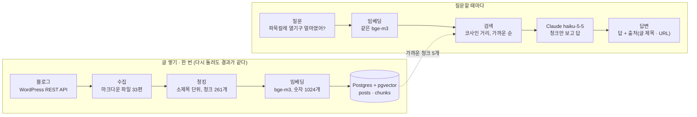

# 블로그 글로 답하는 챗봇 만들기 1주차: 글 모으기부터 pgvector 검색, 에이전트 세 가지까지

2026-10-25 · 이현우

## 들어가며

1주차 결과부터 말하면, 내 여행 블로그 글 33편을 모아 잘게 나누고 숫자로 바꿔 DB에 넣었고, 질문하면 관련 글을 찾아 답하는 챗봇을 세 가지 방식으로 만들어 비교했다.

이 프로젝트는 "내 블로그 글을 근거로 답하는 챗봇"이다. 예를 들어 "파묵칼레 열기구는 얼마였어?"라고 물으면, 챗봇이 내가 쓴 글에서 해당 부분을 찾아 "1인 약 90\~120유로, 픽업은 05\~06시"라고 답하고 출처 글 링크를 붙인다.

이런 챗봇은 도구를 쓰면 하루 만에도 만들 수 있다. 그래도 수집, 저장, 검색, 답변을 하나씩 직접 만들었다. 각 단계에서 무슨 일이 일어나는지 설명할 수 있어야 나중에 문제가 생겨도 고칠 수 있기 때문이다.

이 글은 그 1주차 기록이다. 프로그래밍을 막 시작한 사람도 따라올 수 있게, 용어가 나올 때마다 비유로 먼저 풀어 쓴다.

## RAG가 뭔가요

RAG(Retrieval-Augmented Generation)는 "찾아보고 나서 답하기"다. 오픈북 시험을 떠올리면 쉽다.

- **보통의 AI(클로드, ChatGPT)**: 책 없이 시험 보는 학생이다. 머릿속에 있는 것으로만 답한다. 내 블로그를 읽어 본 적이 없으니 "내가 파묵칼레에서 얼마를 냈는지"는 모른다. 모르는데도 그럴듯하게 지어낼 때가 있다.
- **RAG**: 오픈북 시험이다. 문제를 받으면 먼저 책(내 블로그)에서 관련 페이지를 찾고, 그 페이지를 펼쳐 놓고 답을 쓴다.

그래서 RAG는 두 부분으로 나뉼다.

1. **검색(Retrieval)**: 질문과 관련 있는 글 조각을 찾는다.
2. **생성(Generation)**: 찾은 조각을 AI에게 건네고 "이것만 보고 답해"라고 시킨다.

답의 품질은 대부분 1번에서 갈린다. 엉뚱한 페이지를 펼치면 아무리 똑똑한 AI도 맞는 답을 못 쓴다. 그래서 1주차는 대부분의 시간을 "잘 찾기"에 썼다.

## 전체 구조 한눈에 보기

흐름은 두 줄이다. 윗줄은 글을 미리 쌓아 두는 일이고 한 번만 하면 된다. 아랫줄은 질문이 올 때마다 도는 일이다.

두 줄이 만나는 곳이 데이터베이스다. 질문도 글과 같은 모델로 숫자로 바꿔야 서로 비교할 수 있다. 쓴 도구는 Python, WordPress REST API, PostgreSQL + pgvector, bge-m3(임베딩), Claude(답변), LangGraph(에이전트)다.

## 1단계: 글 모으기

블로그의 공개 글 33편을 파일 33개로 내려받았다. 두 번째 돌려도 파일 33개가 바이트까지 똑같았다.

내 블로그는 워드프레스로 만들어져 있다. 글을 가져오는 방법은 세 가지가 있었다.

| 방법 | 무엇을 주나 | 쓰지 않은 이유 |
| --- | --- | --- |
| RSS(새 글 알림 주소) | 최근 글 10편 | 옛날 글이 빠진다 |
| 사이트맵(글 주소 목록) | 글 33개의 URL | 본문은 페이지를 따로 긁어야 한다 |
| **REST API(선택)** | 글 목록, 본문, 태그, 날짜 | - |

REST API는 "글 목록 주세요", "682번 글 본문 주세요"처럼 주소로 요청하면 데이터를 돌려주는 창구다. 로그인 없이 부르면 공개 글만 돌려주므로, 비공개 글과 임시 글은 저절로 빠진다.

수집 스크립트가 하는 일은 다음과 같다.

1. 글 목록을 받는다.
2. 글마다 본문을 따로 요청한다. 블로그 서버에 부담을 주지 않게 요청 사이에 1초씩 쉰다.
3. 본문 HTML(웹페이지 코드)을 마크다운(읽기 쉬운 텍스트 형식)으로 바꾼다. 사진의 설명 문구(alt)는 살린다.
4. 파일 맨 위에 주소, 제목, 날짜, 태그, 본문 지문(해시)을 적어 저장한다.

여기서 처음 나오는 중요한 개념이 **멱등성**이다. 어려운 말이지만 뜻은 "몇 번을 돌려도 결과가 같다"이다. 저장할 때 파일 이름을 글 주소에서 만들기 때문에, 같은 글은 항상 같은 파일을 덮어쓴다. 그래서 스크립트를 여러 번 돌려도 파일이 늘어나지 않는다.

## 2단계: 잘게 나누기(청킹)

글 33편을 소제목 단위로 잘라 조각 261개를 만들었다. 조각 하나는 평균 497자다.

왜 자를까? "파묵칼레 열기구 픽업 시간"을 물었는데 글 전체(3천 자)를 통째로 건네면, 답이 있는 한 문단이 나머지 이야기에 묻힌다. 반대로 너무 잘게 자르면 "이 가격이 어느 도시 이야기인지" 같은 맥락이 사라진다. 이렇게 글을 검색하기 좋은 크기로 자르는 일을 **청킹(chunking)**, 자른 조각을 청크(chunk)라고 부른다.

선택지는 세 가지였다.

| 방법 | 장점 | 단점 |
| --- | --- | --- |
| 글 1개 = 청크 1개 | 가장 단순하다 | 글 안의 특정 내용을 잘 못 찾는다 |
| 고정 길이(예: 800자) | 길이가 고르다 | 문장 중간에서 잘린다 |
| **소제목 단위(선택)** | 내 글은 소제목마다 장소·시간이 바뀐다 | 섬션 길이가 들쓱날쓱하다 |

내 글은 "## 13시 22분, 모스트라우멘 피오르 크루즈 탑승"처럼 소제목 하나가 장소 하나다. 그래서 소제목 단위가 자연스럽다. 들쓱날쓱한 길이는 규칙 몇 개로 다듬었다.

- 청크 맨 앞에 "글 제목 > 소제목"을 붙인다. 조각만 봐도 어느 글의 어느 부분인지 알 수 있다.
- 200자보다 짧은 섬션은 다음 섬션과 합친다.
- 1500자보다 긴 섬션은 문단 경계에서 자른다.
- 사진은 주소(URL)를 빼고 설명 문구만 남긴다. "구름에 가린 피엘헤이센 케이블카 노선"처럼 사진 설명에도 정보가 많기 때문이다.
- 코드 블록은 어떤 경우에도 자르지 않는다(나중에 개발 글을 넣을 때를 대비한 규칙).

결과는 청크 261개, 가장 짧은 것 233자, 가장 긴 것 1230자였다. 질문 10개로 검색해 보니, 블로그에 답이 있는 질문 8개 모두에서 정답 글이 1위로 나왔다.

## 3단계: 숫자로 바꾸기(임베딩)

청크 261개를 각각 숫자 1024개짜리 목록으로 바꿨다. 이 숫자 목록을 **벡터**, 바꾸는 일을 **임베딩**이라고 한다.

왜 숫자로 바꿀까? 컴퓨터는 "스위스에서 기차 탄 이야기"와 "왜 기차가 아니라 배인가"가 비슷한 내용인지 글자만 보고는 알기 어렵다. 같은 단어가 거의 없기 때문이다. 임베딩 모델은 뜻이 비슷한 문장을 비슷한 숫자로 바꿔 준다.

지도로 떠올리면 쉽다. 모든 문장을 지도 위의 한 점에 찍는다고 상상해 보자. 비슷한 내용은 가까이, 다른 내용은 멀리 찍힌다. 진짜 지도는 가로·세로 2차원이지만, 임베딩 지도는 1024차원이다. 그림으로 그릴 수는 없지만 계산은 같다.

검색은 이 지도에서 일어난다. 질문도 같은 방식으로 점 하나로 찍고, 그 점에서 가장 가까운 청크를 고른다. 가까운 정도는 **코사인 거리**로 재는데, 0이면 같은 방향이고 클수록 멀다. 실제로 "스위스에서 기차 탄 이야기"로 검색하면 1위가 "툰 호수 유람선에서 라우터브루넨까지 > 왜 기차가 아니라 배인가"(거리 0.471)였다. "기차"라는 단어보다 뜻으로 찾은 것이다.

임베딩 모델은 두 가지 중에서 골랐다.

| 종류 | 장점 | 단점 |
| --- | --- | --- |
| API형(외부 서비스에 보내기) | 설치가 가볍다 | API 키가 필요하고 호출마다 비용이 나간다 |
| **내 컴퓨터에서 돌리는 모델(선택)** | 비용 0원, 키 불필요 | 처음에 모델 파일 약 2GB를 내려받아야 한다 |

고른 모델은 **BAAI/bge-m3**다. 한국어를 포함한 여러 언어를 다루고, 문장 하나를 숫자 1024개로 바꾼다. 첫 적재는 모델 내려받기까지 포함해 약 7분, 모델이 있는 상태에서는 약 3분 40초가 걸렸다.

## 4단계: 저장하고 찾기(Postgres + pgvector)

글 33편과 청크 261개를 데이터베이스에 넣었고, 다시 넣어도 행 수가 그대로였다(두 번째는 22초, 임베딩 0번).

데이터베이스는 PostgreSQL(포스트그레스)를 썼다. 엑셀처럼 표(테이블)에 행을 쌓는 프로그램이다. 여기에 **pgvector**라는 확장을 켜면 벡터를 한 칸에 저장하고 "이 벡터와 가까운 순서로" 정렬할 수 있다. 내 컴퓨터에서는 Docker(프로그램을 상자에 담아 돌리는 도구)로 띄웠다.

테이블은 두 개다.

| 테이블 | 한 행이 뜻하는 것 | 주요 칸 | 행 수 |
| --- | --- | --- | --- |
| posts | 글 한 편 | 주소(중복 금지), 제목, 날짜, 태그, 본문, 본문 지문(해시) | 33 |
| chunks | 청크 하나 | 어느 글의 몇 번째 조각인지, 소제목, 텍스트, 벡터(숫자 1024개) | 261 |

**다시 넣어도 안전하게.** 적재 스크립트는 글마다 본문 지문을 비교한다. 지문은 본문을 넣으면 나오는 고유한 문자열이다. 본문이 한 글자라도 바뀌면 지문도 바뀐다.

- 지문이 같으면: 임베딩을 건너뛴다. 느리고 비싼 일을 다시 하지 않는다.
- 지문이 다르면: 청크를 다시 만들고, 그 글의 옛 청크를 지우고 새 청크를 넣는다.

여기서 중요한 것은 "지우고 넣기"를 **트랜잭션** 하나로 묶은 것이다. 트랜잭션은 "전부 되거나 전부 안 되거나"다. 은행 이체에서 내 통장에서는 빠졌는데 상대 통장에 안 들어가는 일이 없는 것과 같다. 넣다가 오류가 나면 지운 것까지 되돌려져서, 어떤 글의 청크가 테이블에서 사라지는 일이 없다. 이 동작은 일부러 오류를 내는 테스트로 확인해 두었다.

**인덱스는 있는데 안 쓴다?** 책의 색인처럼 빨리 찾게 해 주는 것을 인덱스라고 한다. 벡터용으로 HNSW 인덱스를 만들었는데, 실행 계획(EXPLAIN ANALYZE, 데이터베이스가 "어떻게 찾을지" 적어 주는 보고서)을 보니 인덱스를 쓰지 않고 261행을 전부 읽었다.

이건 실수가 아니라 올바른 판단이었다. 얼마 안 되는 쪽지를 찾을 때 색인보다 그냥 넘겨 보는 게 빠른 것과 같다. 실제로 인덱스를 강제로 쓰게 해도 둘 다 약 1.6ms로 차이가 없었다. 데이터가 훨씬 많아지면 데이터베이스가 알아서 인덱스를 고른다.

## 5단계: 답하기, 세 가지 방법

같은 질문에 답하는 챗봇을 세 가지로 만들었다. 질문 10개로 비교해 보니, 가장 단순한 방법이 가장 싸고 빨랐고, 더 똑똑한 방법은 여러 글을 이어야 하는 질문 하나에서만 더 나았다.

세 버전의 차이는 한 가지다. **다음에 무엇을 할지 누가 정하는가.**

1. **워크플로우 v0**: 코드가 정한다. 항상 "질문으로 한 번 검색 → 찾은 청크 5개를 AI에게 주고 답하기"다. 요리 레시피를 그대로 따르는 것과 같다.
2. **프레임워크 없는 에이전트(raw\_loop)**: AI가 정한다. AI에게 도구 두 개(검색, 글 전문 보기)를 주고, AI가 "이 도구를 이 검색어로 써 줘"라고 요청하면 코드가 대신 실행해 결과를 돌려준다. AI가 "이제 답할게"라고 할 때까지 반복한다. 요리사가 냉장고를 보고 재료를 더 꺼낼지 스스로 정하는 것과 같다.
3. **LangGraph 에이전트**: 판단은 2번과 같이 AI가 한다. 다른 점은 반복을 코드의 while 문이 아니라 그래프(노드와 화살표)로 그린다는 것뿐이다. "AI 단계 → 도구를 요청했으면 도구 단계, 아니면 끝"이 화살표로 표현된다.

에이전트가 무한히 도는 것을 막기 위해 상한도 걸었다. raw\_loop는 AI 호출 6번, LangGraph는 10단계를 넘으면 답 없이 멈춘다.

질문은 내 글에서 쉽음 3개, 중간 4개, 어려움 3개를 만들었다. 어려움에는 여러 글을 이어야 하는 질문("튀르키예를 어떤 순서로 이동했어?")과 블로그에 없는 내용("파리 에펠탑 글 있어?")을 넣었다. 모델은 세 버전 모두 가장 저렴한 claude-haiku-5-5를 썼다.

| 버전 | 평균 AI 호출 | 평균 토큰 | 질문당 비용 | 평균 응답 시간 | 원문과 맞은 답 |
| --- | --- | --- | --- | --- | --- |
| 워크플로우 v0 | 1.0번 | 3745 | 약 $0.00056 | 2.7초 | 9/10 |
| raw\_loop | 2.1번 | 6551 | 약 $0.00092 | 4.4초 | 10/10 |
| LangGraph | 2.1번 | 6962 | 약 $0.00097 | 5.0초 | 10/10 |

토큰은 AI가 읽고 쓰는 글자 단위이고, 비용은 이걸로 계산된다. 에이전트는 대부분 "검색 1번 + 답 1번"으로 호출이 2번이라, v0보다 비용이 약 1.7배, 시간이 약 2초 더 들었다.

차이가 난 건 튀르키예 이동 순서 질문 하나다. 이 답은 글 다섯 편에 흩어져 있다. v0는 검색을 한 번만 하므로 부르사에서 이스탄불까지만 답했다. 에이전트 둘은 검색을 한 번 더 해서 카파도키아 → 안탈리아 → 파묵칼레 → 부르사 → 이스탄불 순서를 모두 맞혔다. 블로그에 없는 파리 질문에는 세 버전 모두 "없다"고 제대로 답했다.

그래서 결론은 이렇게 내렸다. **기본은 단순한 v0, 여러 글을 이어야 하는 질문만 에이전트.** 다만 질문 10개 중 그런 질문이 하나뿐이라 표본이 작다. 2주차에 질문을 늘려 다시 확인한다.

하나 더 배운 것이 있다. LangGraph는 대화 기록을 State(상태)라는 그릇에 담는데, 새 메시지를 "덮어쓰지 말고 뒤에 붙여라"는 규칙(리듀서)을 빼 보았다. 그러자 질문이 사라지고 도구 결과만 남아서, AI 서비스가 "요청한 적 없는 도구 결과가 왔다"며 오류(400)를 냈다. 한 줄짜리 설정이 왜 필요한지 직접 깨뜨려 보고 알았다.

## 실수에서 배운 것

이번 주에 틀린 것 세 가지를 "하네스 로그"에 적었다. 하네스 로그는 무엇이 틀렸고, 왜 틀렸고, 다음에 무엇으로 막을지 적는 오답노트다. 이 프로젝트는 AI 코딩 도구와 함께 만들고 있는데, 세 건 모두 도구 쪽의 실수였다.

| 무엇이 틀렸나 | 왜 | 배운 것 |
| --- | --- | --- |
| API 키 인증 실패 원인을 "키 종류가 틀렸다"고 설명했다. 실제 원인은 화면에 가운데가 가려진 채 보이는 키를 그대로 붙여넣은 것이었다. | 키 형식을 문서가 아니라 기억으로 판단했다. | 키는 만든 직후에만 전체가 보인다. 인증이 실패하면 키 값은 보지 않고 모양(길이, `...` 포함 여부)부터 확인한다. |
| 검색 SQL을 "두 테이블을 합친 뒤 정렬"하는 모양으로 썼다. 이러면 데이터가 많아져도 인덱스를 못 쓴다. | 인덱스를 타는지 실행 계획으로 확인하지 않고 썼다. | 청크에서 가까운 k개를 먼저 뽑고 그다음에 합치도록 고쳤다. SQL은 EXPLAIN으로 확인한다. |
| 실행 계획 결과를 대화로만 보고하고 README에 남기지 않았다. | 주차 완료 기준과 대조하지 않았다. | 작업을 끝낼 때 완료 기준을 하나씩 실제로 실행해 본다. |

AI와 같이 만들면 속도는 빠르지만, 그럴듯한 설명을 그대로 믿기 쉽다. 세 건 모두 "실제로 돌려 보고 확인하기"로 찾았다. 그래서 이 프로젝트에는 "내가 설명하지 못하는 코드는 다음 단계로 넘기지 않는다"는 규칙을 두었다.

## 정리와 다음 주

1주차에는 블로그 글을 찾아 답하는 뚜대기를 처음부터 끝까지 이었다. 숫자로 요약하면 이렇다.

- 글 33편 → 청크 261개(평균 497자) → 벡터(숫자 1024개씩)
- 다시 적재해도 행 수 그대로, 재임베딩 0번
- 질문 10개 기준 단순한 v0는 질문당 약 $0.00056·2.7초, 에이전트는 약 $0.00092\~0.00097·4.4\~5.0초
- 블로그에 답이 있는 질문 8개 모두 정답 글이 검색 1위

2주차에 할 일은 두 가지다.

1. **평가**: 지금은 답이 맞았는지 내가 눈으로 비교했다. 질문을 늘리고, "맞았다"의 기준을 정해서 자동으로 채점한다. 출처 제목을 틀리게 적거나 원문에 없는 내용을 덧붙이는 경우도 잡아야 한다.
2. **라우팅**: 질문을 보고 v0로 보낼지 에이전트로 보낼지 고르는 부분이다. 규칙으로 나눌지, AI에게 분류를 맡길지는 아직 정하지 않았다.

코드와 실험 결과, 판단 기록은 모두 GitHub 저장소 [HYUNWOOL/blog-rag-agent](https://github.com/HYUNWOOL/blog-rag-agent)에 있다.
